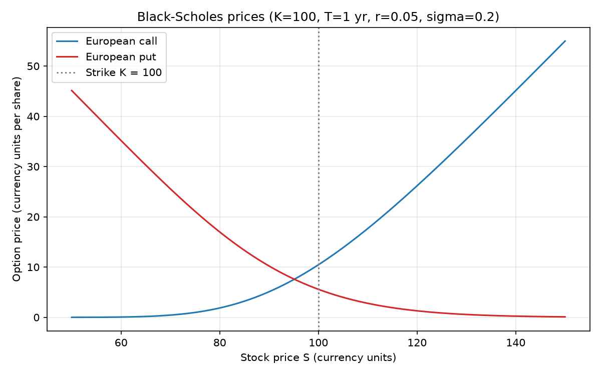
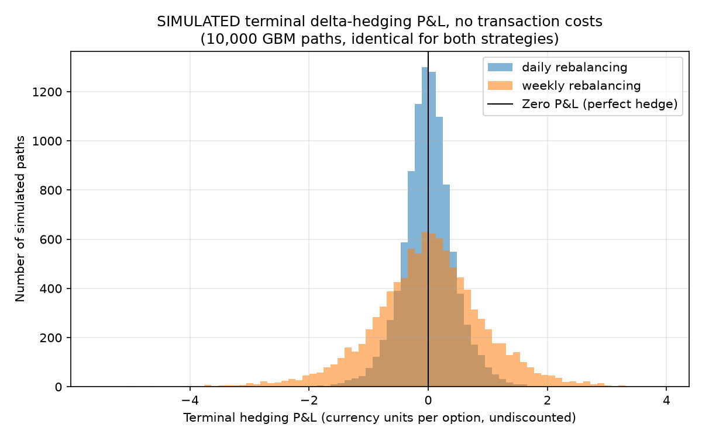
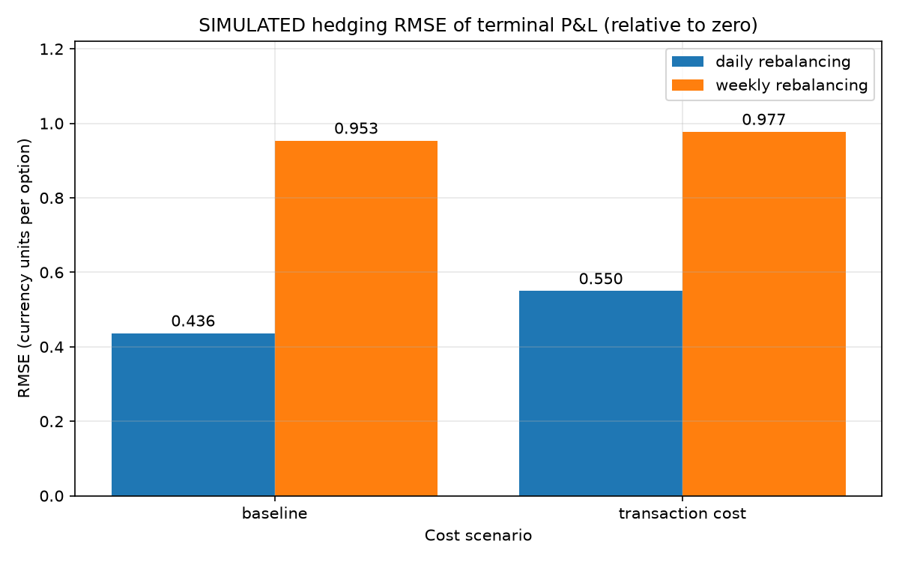

# Black–Scholes Option Pricer and Delta-Hedging Simulation

A small, tested Python research project that prices European options with the
Black–Scholes formula, computes the Greeks and implied volatility, and uses
**simulated** stock paths to study how well a delta hedge of a short call
works when it is rebalanced daily versus weekly, with and without transaction
costs.

## Project status

* Implementation, tests, experiments, figures and documentation are complete
  for the scope below.
* Test suite: **992 passed, 16 skipped (documented), 0 failed**
  ([validation](docs/validation.md)).
* Both experiments were run at full size (10,000 paths × 252 steps).
* All market data are **simulated**; no external data, services or API keys.

## Features

* Analytical European call and put prices (no dividends), with explicit expiry
  (T = 0) and zero-volatility handling and input validation.
* Delta, gamma, vega, theta and rho in documented raw units, plus labelled
  human-readable units (per vol point, per rate point, per calendar day).
* Implied volatility with `scipy.optimize.brentq`, no-arbitrage bound checks and
  a documented bracketing policy.
* Exact geometric Brownian motion simulation with a fixed seed.
* Self-financing delta-hedging engine with interest accrual and proportional
  transaction costs.
* Daily vs weekly rebalancing on identical paths, with and without 5 bp costs.
* Reproducible CSV/JSON outputs, six charts and a generated report.

## The financial question

If you sell a call at its Black–Scholes price and hedge it by holding delta
shares, the model says that continuous, costless trading would exactly cover
the payoff. In practice trading is discrete and costs money. **How large is the
leftover hedging error when rebalancing daily versus weekly, and how do
transaction costs change that comparison?**

## Installation

Requires Python 3.11 or later (tested with 3.14.4). Run all commands from the
project root folder. Quote the path because the folder name contains spaces.

### Windows PowerShell

```powershell
cd "path\to\Black-Scholes Option Pricer and Delta Hedger simulation"
py -3 -m venv .venv
.\.venv\Scripts\Activate.ps1
python -m pip install --upgrade pip
python -m pip install -e ".[dev]"
```

If script execution is blocked, run
`Set-ExecutionPolicy -Scope Process -ExecutionPolicy Bypass` in the same
window first, or call `.\.venv\Scripts\python.exe` directly.

### macOS / Linux

```bash
cd "path/to/Black-Scholes Option Pricer and Delta Hedger simulation"
python3 -m venv .venv
source .venv/bin/activate
python -m pip install --upgrade pip
python -m pip install -e ".[dev]"
```

To reproduce the exact tested versions, use
`python -m pip install -r requirements-lock.txt` followed by
`python -m pip install -e . --no-deps`. The lock file is a snapshot of the
tested Windows / Python 3.14 environment and may need adjustment elsewhere.

## Quick start (complete workflow)

```bash
python -m pytest -q --junitxml=results/test_results.xml
python scripts/sanitize_test_xml.py
python scripts/price_option.py --spot 100 --strike 100 --maturity 1 --rate 0.05 --volatility 0.20 --option-type call --output-json results/example_option.json
python scripts/run_experiments.py --config configs/baseline.json
python scripts/run_experiments.py --config configs/transaction_costs.json
python scripts/generate_report.py
```

Every script has `--help`. `run_experiments.py` accepts `--output-dir` and
`generate_report.py` accepts `--results-dir` (both default to `results/`).

## Example option output (actual run)

```
European call  S=100  K=100  T=1 yr  r=0.05  sigma=0.2  (q=0, one share)
Price                         : 10.450584
Raw Greeks
  delta                       : 0.636831
  gamma                       : 0.018762
  vega  (per 1.0 vol)         : 37.524035
  theta (per year)            : -6.414028
  rho   (per 1.0 rate)        : 53.232482
Scaled Greeks
  vega  (per 1 vol point)     : 0.375240
  theta (per calendar day/365): -0.017573
  rho   (per 1 rate point)    : 0.532325
Implied vol from this price   : 0.2000000000
```

## Results summary (actual run, simulated data)

S0 = K = 100, T = 1, r = μ = 5%, σ = 20%, 252 steps, 10,000 paths, seed 42.
Terminal P&L of the hedged option seller, currency units per option,
undiscounted. RMSE is measured relative to zero.

| Scenario | Strategy | Mean P&L | Std (ddof=1) | RMSE | Mean cost |
|---|---|---|---|---|---|
| No costs | Daily | 0.0019 | 0.4364 | 0.4363 | 0.0000 |
| No costs | Weekly | −0.0013 | 0.9535 | 0.9535 | 0.0000 |
| 5 bp costs | Daily | −0.3153 | 0.4502 | 0.5496 | 0.3093 |
| 5 bp costs | Weekly | −0.1808 | 0.9604 | 0.9773 | 0.1752 |

* Without costs, both means are within two standard errors of zero; weekly RMSE
  was 2.19× daily RMSE.
* Daily rebalancing ended closer to zero than weekly on 74.1% of paths, not on
  all of them.
* With 5 bp costs, daily paid 1.77× the costs of weekly; it still had the lower
  RMSE at this cost level, but its mean P&L was more negative.

Details and caveats: [docs/results.md](docs/results.md) and the generated
[results/report.md](results/report.md).







## Repository structure

```
README.md, pyproject.toml, requirements-lock.txt, LICENSE
configs/      baseline.json, transaction_costs.json
src/bs_hedging/
              validation.py  pricing.py  greeks.py  implied_vol.py
              simulation.py  hedging.py  metrics.py  plotting.py
scripts/      price_option.py  run_experiments.py  generate_report.py
              sanitize_test_xml.py (strips hostname/absolute paths from test XML)
              _common.py (shared path/metadata helpers)
tests/        test_pricing.py  test_greeks.py  test_implied_vol.py
              test_simulation.py  test_hedging.py  test_metrics.py
docs/         methodology.md  results.md  learning_guide.md  validation.md
results/      CSV/JSON outputs, test_results.xml, report.md, figures/
```

## Testing

```bash
python -m pytest -q
```

Tests include independent textbook reference values, finite-difference checks
of the Greeks, hand-calculated hedge cash balances, and hand-computed metric
values. See [docs/validation.md](docs/validation.md).

## Key assumptions and limitations

* European options only, no dividends (q = 0), constant r and σ, GBM paths.
* One option on one share; no contract multiplier.
* μ = r in the baseline is a modelling choice, not a claim about real returns.
* Hedging volatility equals simulated volatility, so model risk is not studied.
* Proportional stock costs only; no option bid–ask spread.
* One parameter set and one seed; results are Monte Carlo estimates.
* Not investment advice and not connected to any trading system.

## Documentation

* [Methodology](docs/methodology.md) — formulas, units, cash-account equations.
* [Results](docs/results.md) — tables and interpretation.
* [Learning guide](docs/learning_guide.md) — plain-language explanation and self-check questions.
* [Validation](docs/validation.md) — tests, tolerances and actual outcome.
* [Results folder guide](results/README.md) — file descriptions and units.

## References

* Black, F. and Scholes, M. (1973). The Pricing of Options and Corporate
  Liabilities. *Journal of Political Economy*, 81(3), 637–654.
* Merton, R. C. (1973). Theory of Rational Option Pricing. *Bell Journal of
  Economics and Management Science*, 4(1), 141–183.
* Hull, J. C. *Options, Futures, and Other Derivatives*. Pearson (chapters on
  the Black–Scholes–Merton model and the Greek letters; numbering varies by
  edition).
* Boyle, P. P. and Emanuel, D. (1980). Discretely Adjusted Option Hedges.
  *Journal of Financial Economics*, 8(3), 259–282.
* Leland, H. E. (1985). Option Pricing and Replication with Transactions Costs.
  *Journal of Finance*, 40(5), 1283–1301.
* Glasserman, P. (2003). *Monte Carlo Methods in Financial Engineering*.
  Springer.
* Brent, R. P. (1973). *Algorithms for Minimization without Derivatives*.
  Prentice-Hall.
* Hyndman, R. J. and Fan, Y. (1996). Sample Quantiles in Statistical Packages.
  *The American Statistician*, 50(4), 361–365.
* SciPy documentation for `scipy.optimize.brentq`:
  https://docs.scipy.org/doc/scipy/reference/generated/scipy.optimize.brentq.html

## License

MIT — see [LICENSE](LICENSE).
