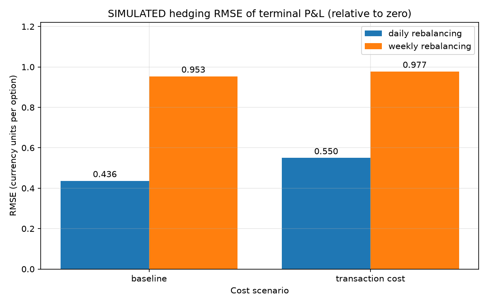
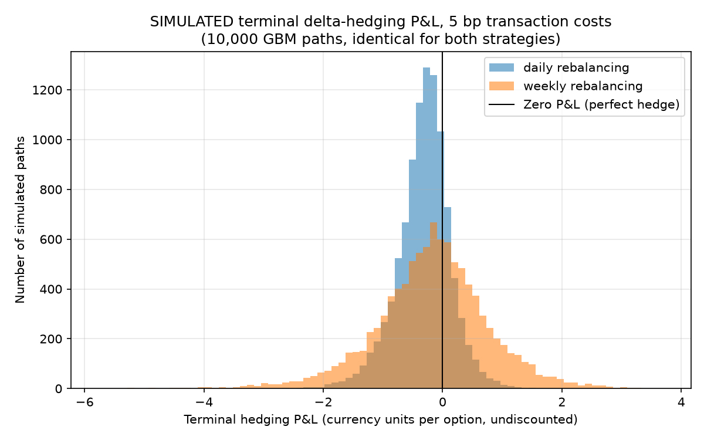

# Results

All numbers below are copied from files produced by actual runs on
2026-11-15 (UTC timestamps in [`results/run_metadata.json`](../results/run_metadata.json)).
The full generated report is [`results/report.md`](../results/report.md).
**All stock prices are simulated** (geometric Brownian motion); no market data
were used.

## Configurations

Both scenarios use identical simulation parameters and seed, so they run on the
**same 10,000 simulated paths**; only the transaction-cost rate differs.

| Parameter | Value |
|---|---|
| Initial stock price S0 | 100 |
| Strike K | 100 |
| Maturity T | 1 year |
| Risk-free rate r | 0.05 |
| Simulation drift μ | 0.05 (μ = r is a modelling choice) |
| Simulated volatility | 0.20 |
| Hedging volatility | 0.20 |
| Dividend yield | 0 |
| Trading steps | 252 |
| Paths | 10,000 |
| Seed | 42 |
| Strategies | daily (every step), weekly (every 5 steps) |
| Transaction-cost rate | 0 ([`configs/baseline.json`](../configs/baseline.json)) and 0.0005 = 5 bp ([`configs/transaction_costs.json`](../configs/transaction_costs.json)) |

Premium received (Black–Scholes call, σ = 0.20): **10.4506**.

## Comparison tables

Terminal hedging P&L, currency units per option, undiscounted; positive =
profit for the option seller. Std uses ddof = 1; RMSE is relative to zero.

| Scenario | Strategy | Mean | Std | SE of mean | RMSE | 5th pct | Median | 95th pct | Min | Max | Mean cost |
|---|---|---|---|---|---|---|---|---|---|---|---|
| No costs | Daily | 0.0019 | 0.4364 | 0.0044 | 0.4363 | −0.7129 | 0.0014 | 0.7210 | −2.9963 | 1.9694 | 0.0000 |
| No costs | Weekly | −0.0013 | 0.9535 | 0.0095 | 0.9535 | −1.5554 | 0.0175 | 1.5324 | −5.5278 | 3.9033 | 0.0000 |
| 5 bp costs | Daily | −0.3153 | 0.4502 | 0.0045 | 0.5496 | −1.0942 | −0.2817 | 0.3635 | −3.4272 | 1.5278 | 0.3093 |
| 5 bp costs | Weekly | −0.1808 | 0.9604 | 0.0096 | 0.9773 | −1.7748 | −0.1490 | 1.3456 | −5.7564 | 3.6876 | 0.1752 |

Paired, same-path comparisons:

| Scenario | Paths where daily ended closer to zero than weekly | Mean (daily − weekly) P&L | SE |
|---|---|---|---|
| No costs | 74.14% | 0.0031 | 0.0085 |
| 5 bp costs | 67.76% | −0.1344 | 0.0087 |

| Strategy | Mean nominal cost | Mean same-path P&L reduction from costs |
|---|---|---|
| Daily | 0.3093 | 0.3171 |
| Weekly | 0.1752 | 0.1796 |

## Interpretation of the observed outputs

1. **Without costs, both hedges are centred near zero.** Mean P&L was 0.0019
   (daily) and −0.0013 (weekly), each well within two standard errors of zero.
   This matches the expectation that a premium set at the model price, with the
   model volatility equal to the simulated volatility, has close to zero
   expected hedging P&L. The residual comes from discrete rebalancing.
2. **Less frequent rebalancing produced a wider P&L distribution.** Weekly RMSE
   (0.9535) was 2.19 times daily RMSE (0.4363). For reference, √(252/51) ≈ 2.22;
   the observed ratio is consistent with the approximate square-root scaling of
   discrete-hedging error with the number of rebalances discussed by Boyle and
   Emanuel (1980), though this experiment does not test that relation formally.
3. **Daily was not better on every path.** On the remaining 25.86% of paths the
   weekly hedge ended at least as close to zero as the daily hedge (no-cost case).
4. **Transaction costs shifted the mean and changed the trade-off.** With 5 bp
   costs, daily rebalancing paid 1.77× the mean nominal cost of weekly
   rebalancing (0.3093 vs 0.1752). The mean P&L became −0.3153 (daily) and
   −0.1808 (weekly). Because the mean is now negative, RMSE exceeds the standard
   deviation (e.g. daily RMSE 0.5496 vs std 0.4502). Daily still had the lower
   RMSE at this cost level (0.5496 vs 0.9773), but the RMSE gap narrowed from a
   ratio of 2.19 to 1.78.
5. **Costs reduced P&L by slightly more than the nominal cost.** The same-path
   P&L reduction (0.3171 daily, 0.1796 weekly) exceeded the nominal cost
   (0.3093, 0.1752) because cash spent on costs no longer earns 5% interest.

## Sampling uncertainty and limitations

* Standard errors of the means are 0.004–0.010; differences in means smaller
  than about twice these values should not be interpreted.
* Results are for a single parameter set, one seed and 10,000 paths. RMSE and
  percentile estimates carry Monte Carlo error that is not reported here as a
  confidence interval.
* At a different cost rate, volatility, or maturity, the ranking of daily and
  weekly rebalancing by RMSE could change; this study does not establish the
  cost level at which it would.
* Hedging volatility equals simulated volatility, so volatility mis-specification
  (model risk) is not studied.
* Model limitations: constant volatility and rates, no dividends, no jumps, no
  option bid–ask spread, proportional stock costs only, one option on one share.
