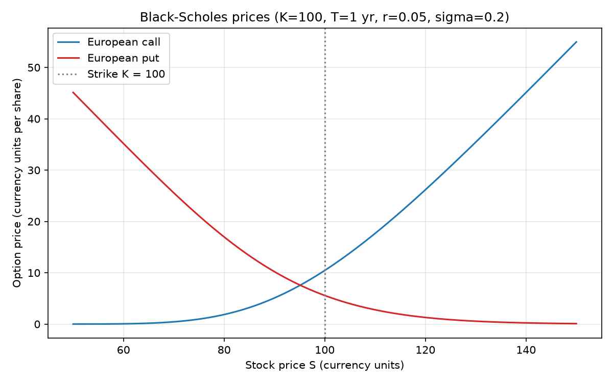
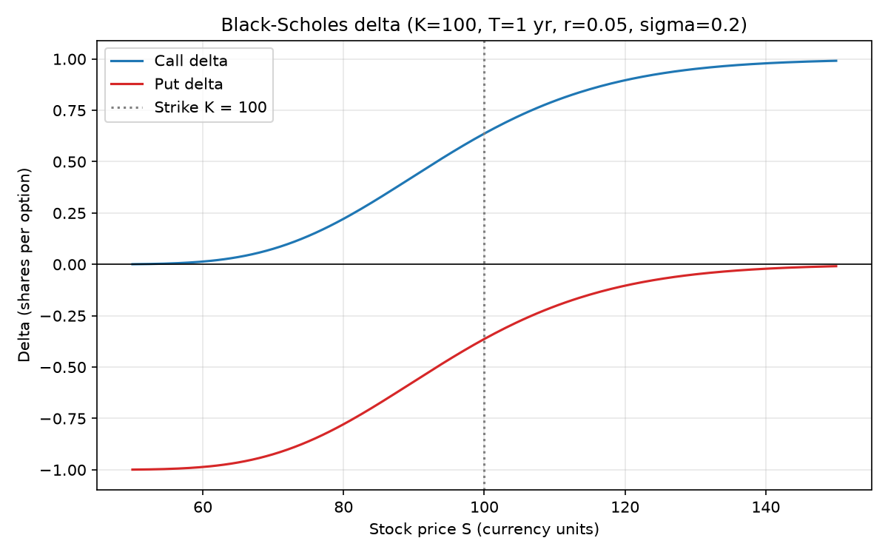
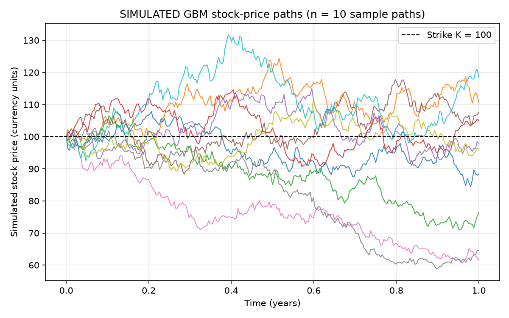
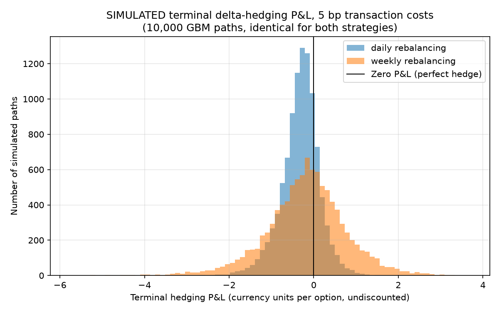
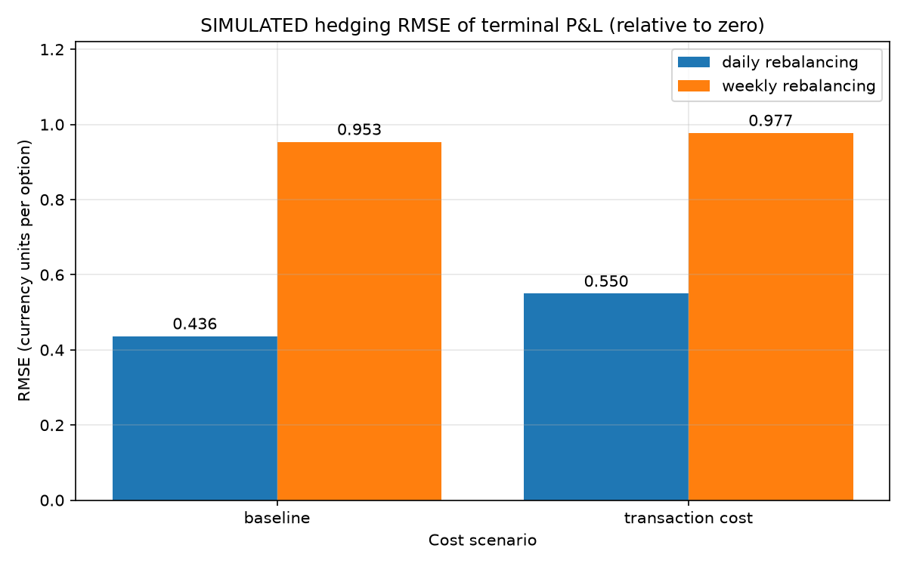

# Report: Delta-Hedging a Short European Call (Simulated Data)

_Generated by `python scripts/generate_report.py` at 2026-11-15T08:50:58Z from the saved files in this folder. All stock prices are **simulated** with geometric Brownian motion; no market data are used._

## Overview

A trader sells one European call on one share at its Black-Scholes price, holds the model delta in stock, and finances trades through a cash account at the risk-free rate. The terminal cash after liquidating the stock and paying the option payoff is the hedging P&L (positive = profit for the option seller; terminal, undiscounted, currency units per option). Daily and weekly rebalancing are compared on identical simulated paths, without and with a 5 basis-point proportional stock transaction cost.

## Configuration

| Parameter | Value |
|---|---|
| initial_stock_price | 100.0 |
| strike | 100.0 |
| maturity_years | 1.0 |
| risk_free_rate | 0.05 |
| simulation_drift | 0.05 |
| simulation_volatility | 0.2 |
| hedging_volatility | 0.2 |
| dividend_yield | 0.0 |
| trading_steps | 252 |
| n_paths | 10000 |
| random_seed | 42 |
| strategies (rebalance every N steps) | {'daily': 1, 'weekly': 5} |
| transaction_cost_rate (baseline / cost scenario) | 0.0 / 0.0005 |

Same simulated paths in both scenarios (identical seed and simulation parameters in the two saved configs): **yes**.

## Example option

European call, S=100.0, K=100.0, T=1.0, r=0.05, sigma=0.2:

| Quantity | Value |
|---|---|
| Price | 10.450584 |
| Delta | 0.636831 |
| Gamma | 0.018762 |
| Vega per 1.0 vol | 37.524035 |
| Vega per vol point | 0.375240 |
| Theta per year | -6.414028 |
| Theta per calendar day (/365) | -0.017573 |
| Rho per 1.0 rate | 53.232482 |
| Rho per rate point | 0.532325 |

## Results

| Scenario | Strategy | Hedge dates (incl. t=0) | Mean P&L | Std (ddof=1) | Std. error of mean | RMSE vs 0 | 5th pct | Median | 95th pct | Min | Max | Mean cost |
|---|---|---|---|---|---|---|---|---|---|---|---|---|
| baseline | daily | 252 | 0.0019 | 0.4364 | 0.0044 | 0.4363 | -0.7129 | 0.0014 | 0.7210 | -2.9963 | 1.9694 | 0.0000 |
| baseline | weekly | 51 | -0.0013 | 0.9535 | 0.0095 | 0.9535 | -1.5554 | 0.0175 | 1.5324 | -5.5278 | 3.9033 | 0.0000 |
| transaction_cost | daily | 252 | -0.3153 | 0.4502 | 0.0045 | 0.5496 | -1.0942 | -0.2817 | 0.3635 | -3.4272 | 1.5278 | 0.3093 |
| transaction_cost | weekly | 51 | -0.1808 | 0.9604 | 0.0096 | 0.9773 | -1.7748 | -0.1490 | 1.3456 | -5.7564 | 3.6876 | 0.1752 |

### Paired comparisons (same simulated paths)

| Scenario | Share of paths with smaller absolute P&L under daily than weekly | Mean (daily - weekly) P&L | Std. error of that mean |
|---|---|---|---|
| baseline | 74.14% | 0.0031 | 0.0085 |
| transaction_cost | 67.76% | -0.1344 | 0.0087 |

| Strategy | Mean nominal cost paid | Mean P&L reduction caused by costs (baseline P&L - cost-scenario P&L, same path) |
|---|---|---|
| daily | 0.3093 | 0.3171 |
| weekly | 0.1752 | 0.1796 |

## Figures

## Interpretation (derived from the numbers above)

- In the **baseline** scenario, daily rebalancing had a lower RMSE than weekly rebalancing (0.4363 vs 0.9535; ratio weekly/daily = 2.19).
  On 74.1% of the identical simulated paths the daily strategy ended closer to zero P&L than the weekly strategy, so it was not better on every path.
- In the **transaction_cost** scenario, daily rebalancing had a lower RMSE than weekly rebalancing (0.5496 vs 0.9773; ratio weekly/daily = 1.78).
  On 67.8% of the identical simulated paths the daily strategy ended closer to zero P&L than the weekly strategy, so it was not better on every path.
- With 5 bp costs, the mean P&L of **daily** rebalancing moved from 0.0019 to -0.3153; mean nominal costs were 0.3093 and the same-path P&L reduction was 0.3171 (slightly larger than nominal costs because cash paid for costs would otherwise have earned interest).
- With 5 bp costs, the mean P&L of **weekly** rebalancing moved from -0.0013 to -0.1808; mean nominal costs were 0.1752 and the same-path P&L reduction was 0.1796 (slightly larger than nominal costs because cash paid for costs would otherwise have earned interest).
- Daily rebalancing paid 1.77 times the mean transaction cost of weekly rebalancing (0.3093 vs 0.1752), illustrating the trade-off between hedging error and trading cost under this particular cost level and parameter set.
- baseline/daily: mean P&L 0.0019 with standard error 0.0044 -> not distinguishable from zero at roughly two standard errors.
- baseline/weekly: mean P&L -0.0013 with standard error 0.0095 -> not distinguishable from zero at roughly two standard errors.
- transaction_cost/daily: mean P&L -0.3153 with standard error 0.0045 -> more than two standard errors away from zero.
- transaction_cost/weekly: mean P&L -0.1808 with standard error 0.0096 -> more than two standard errors away from zero.

## Limitations

- Results come from one simulated parameter set and one random seed; other parameters, costs or seeds can change magnitudes and, potentially, rankings.
- The hedging volatility equals the simulated volatility, so model risk from mis-specified volatility is not studied here.
- Constant volatility and rates, no dividends, no jumps, continuous-price GBM, no option bid-ask spread, proportional stock costs only.
- Standard errors reflect Monte Carlo sampling noise only, not model uncertainty.
- P&L is terminal and undiscounted, per option on one share.
